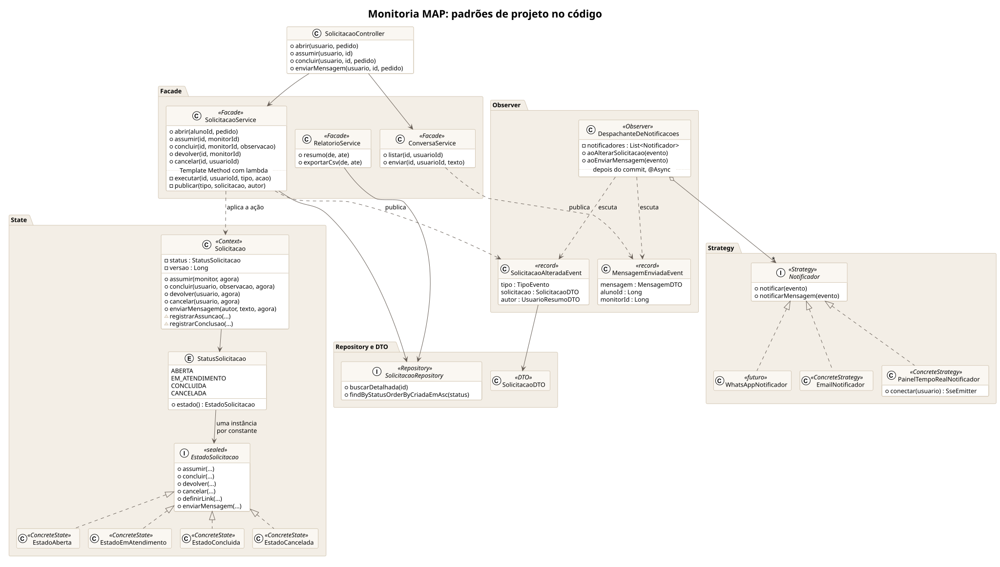
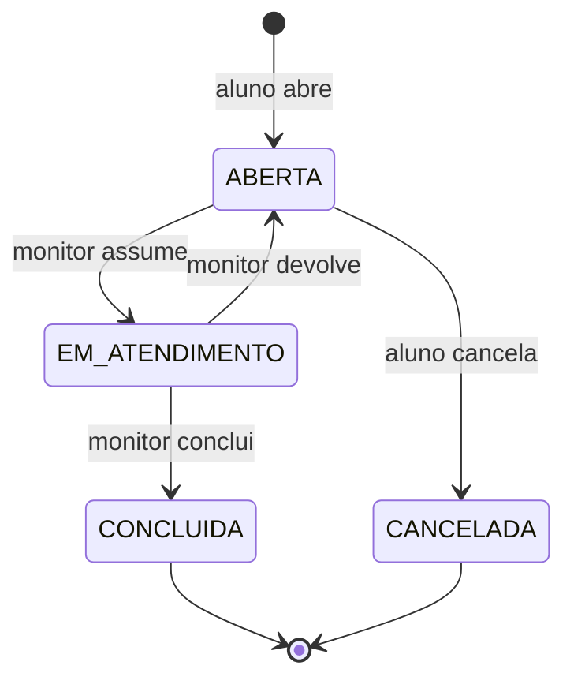
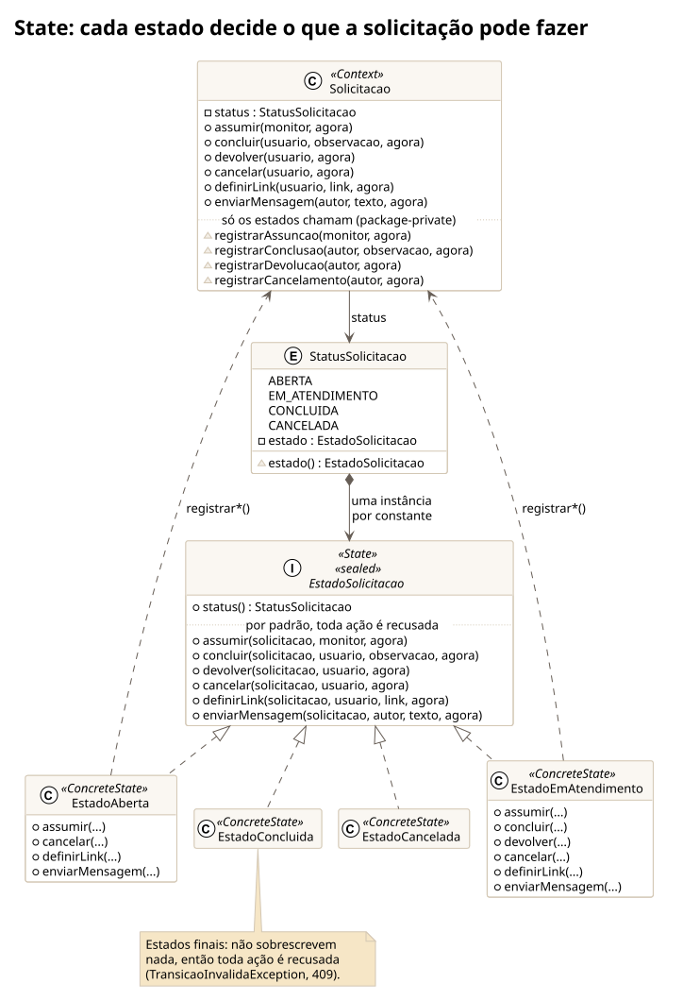
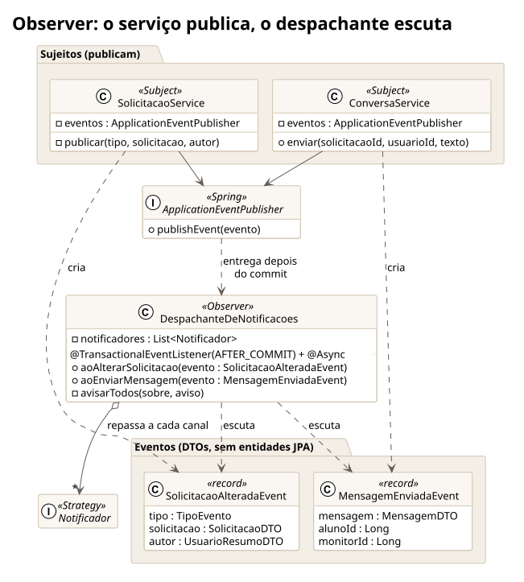
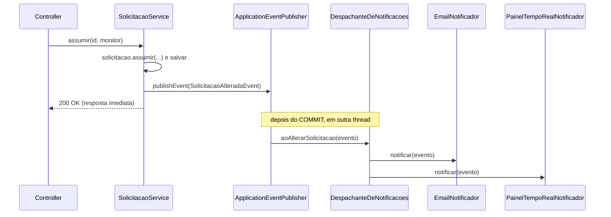
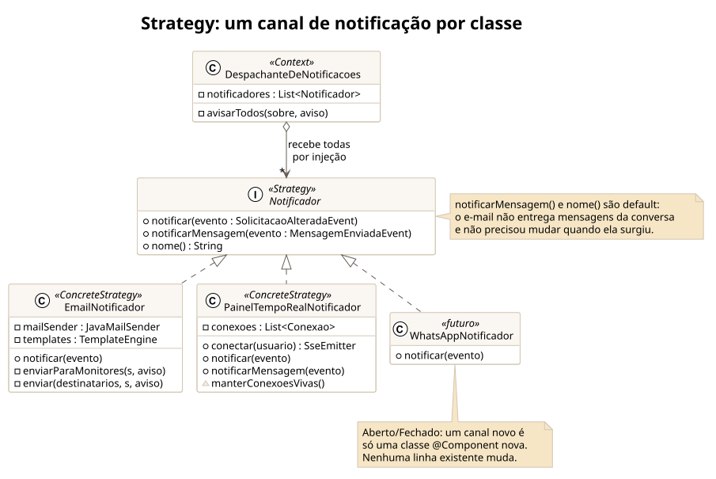
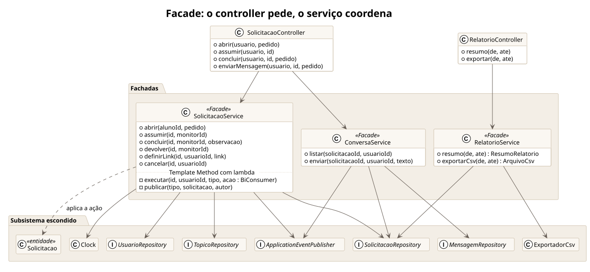
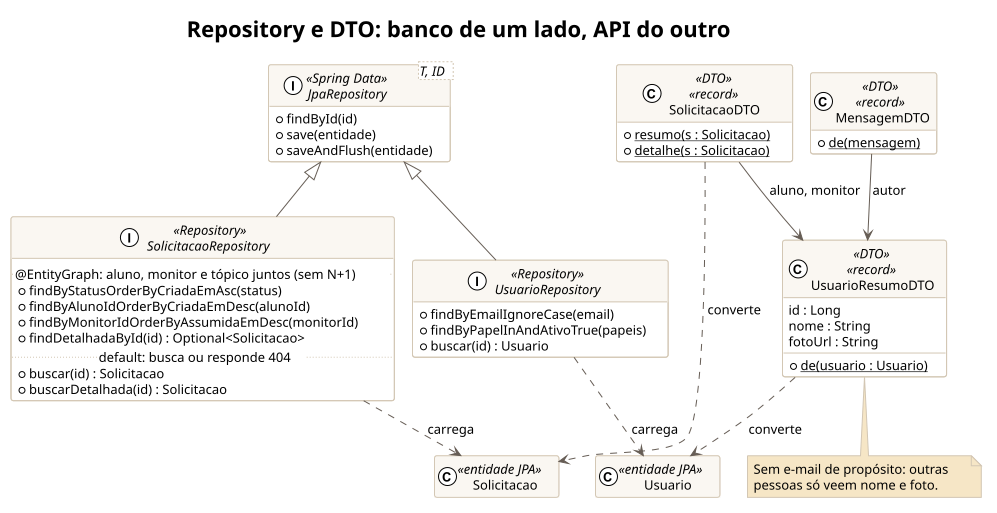

# Padrões de projeto no Monitoria MAP

Este sistema também é material de estudo para a disciplina de **Métodos Avançados em Programação**.
Cada seção abaixo mostra um problema real do projeto, o padrão escolhido para resolvê-lo e onde ele
está no código.

Visão geral: cada pacote do diagrama é um padrão, e as setas mostram como eles se ligam. O serviço
(Facade) aplica a ação na solicitação (State) e publica um evento (Observer), que chega a cada canal de
notificação (Strategy). A fonte está em [diagramas/classes-padroes.puml](diagramas/classes-padroes.puml).



---

## 1. State: o ciclo de vida da solicitação

### Problema
Uma solicitação passa por vários estados, e cada ação só faz sentido em alguns deles:

| Ação ↓ / Estado → | ABERTA | EM_ATENDIMENTO | CONCLUIDA | CANCELADA |
|---|---|---|---|---|
| assumir  | ✅ | ❌ "já foi assumida por Ana" | ❌ | ❌ |
| concluir | ❌ | ✅ (só o responsável) | ❌ | ❌ |
| devolver | ❌ | ✅ (só o responsável) | ❌ | ❌ |
| cancelar | ✅ (só o aluno) | ❌ | ❌ | ❌ |

A solução ingênua é encher a classe de `if (status == ...)`. Isso funciona, mas cada regra nova
espalha condições pelo código, e fica fácil esquecer um caso.

### Solução
Cada estado vira uma classe que sabe responder a cada ação. A `Solicitacao` só **delega**:

```java
public void assumir(Usuario monitor, Instant agora) {
    status.estado().assumir(this, monitor, agora);   // sem nenhum if
}
```

A interface define que, **por padrão, toda ação é inválida**. Cada estado sobrescreve só o que permite:

```java
sealed interface EstadoSolicitacao permits EstadoAberta, EstadoEmAtendimento, EstadoConcluida, EstadoCancelada {
    default void assumir(Solicitacao s, Usuario monitor, Instant agora) {
        throw TransicaoInvalidaException.de(status(), "assumir");
    }
    // concluir, devolver, cancelar... idem
}
```





### Detalhes que valem discutir em aula
- **Encapsulamento.** Os métodos `registrar*` da `Solicitacao` são *package-private*. Só os estados (no
  mesmo pacote) conseguem chamá-los, então ninguém de fora muda o status pulando as regras.
- **`sealed`** (Java 17) garante que não existem outros estados além dos quatro listados.
- **Estados sem campos** podem ser compartilhados: cada constante do `enum` guarda uma única instância.
- O banco guarda só o `enum` (texto `"ABERTA"`). O objeto de estado é derivado dele.
- **Nem toda regra do State muda o status.** `definirLink` e `enviarMensagem` não mudam o estado, mas
  *quem pode* fazê-las depende dele: a conversa só existe em `EM_ATENDIMENTO` e só entre o aluno e o
  monitor responsável. Por isso essas regras também moram nos estados, em vez de virar `if`s no serviço:

```java
// EstadoSolicitacao: por padrão a conversa já terminou (CONCLUIDA e CANCELADA herdam isto)
default MensagemSolicitacao enviarMensagem(Solicitacao s, Usuario autor, String texto, Instant agora) {
    throw new TransicaoInvalidaException("A conversa foi encerrada com o atendimento.");
}

// EstadoAberta: ainda não há com quem conversar
public MensagemSolicitacao enviarMensagem(...) {
    throw new TransicaoInvalidaException("A conversa começa quando um monitor assumir o pedido.");
}

// EstadoEmAtendimento: só os dois envolvidos escrevem
public MensagemSolicitacao enviarMensagem(Solicitacao s, Usuario autor, String texto, Instant agora) {
    if (!s.foiAbertaPor(autor) && !s.estaSendoAtendidaPor(autor)) throw new AcessoNegadoException(...);
    return s.criarMensagem(autor, texto, agora);
}
```

- **Armadilha que já aconteceu aqui.** A primeira versão do `enviarMensagem` padrão escolhia a mensagem
  com um `switch (status())` dentro da própria interface. Funciona, mas é o condicional que o State
  existe para eliminar: se surgir um estado novo, alguém precisa lembrar de mexer no `switch`. A
  correção foi deixar cada estado responder por si (*Substituir Condicional por Polimorfismo*).

📁 `backend/src/main/java/br/monitoriamap/solicitacao/`
`Solicitacao.java`, `StatusSolicitacao.java`, `EstadoSolicitacao.java`, `Estado*.java`
🧪 `SolicitacaoTest.java` testa cada transição, sem banco e sem Spring.

---

## 2. Observer: avisar sem acoplar

### Problema
Quando algo acontece com uma solicitação, várias partes do sistema precisam reagir: o painel em tempo
real, o e-mail e, no futuro, o WhatsApp. Se o `SolicitacaoService` chamasse cada uma diretamente, ele
dependeria de todas e teria de mudar a cada canal novo.

### Solução
O serviço apenas **publica um evento**. Quem tiver interesse **observa**:

```java
// SolicitacaoService: não sabe quem está ouvindo
eventos.publishEvent(new SolicitacaoAlteradaEvent(TipoEvento.ASSUMIDA, dto, autor));
```

```java
// DespachanteDeNotificacoes: o observador
@Async
@TransactionalEventListener(phase = TransactionPhase.AFTER_COMMIT)
public void aoAlterarSolicitacao(SolicitacaoAlteradaEvent evento) { ... }
```





- **`AFTER_COMMIT`**: só avisa se a transação deu certo. Ninguém recebe "assumida" de algo que foi desfeito.
- **`@Async`**: o monitor que clicou em "Assumir" não espera o e-mail ser enviado.
- O evento carrega um **DTO**, não a entidade JPA, porque os observadores rodam depois do commit e em outra
  thread, onde a sessão do Hibernate já foi fechada.

- **Um segundo evento, o mesmo mecanismo.** Uma mensagem nova na conversa publica
  `MensagemEnviadaEvent`. O despachante ganhou um segundo método de escuta, e o `ConversaService` não
  sabe quem vai entregar a mensagem.

📁 `solicitacao/SolicitacaoAlteradaEvent.java`, `solicitacao/MensagemEnviadaEvent.java`,
`notificacao/DespachanteDeNotificacoes.java`

---

## 3. Strategy: um canal de notificação por classe

### Problema
Cada canal envia de um jeito: SSE para o navegador, SMTP para e-mail, uma API para WhatsApp. Mas, para
quem dispara, todos fazem a mesma coisa: *notificar*.

### Solução
Uma interface com várias implementações intercambiáveis:

```java
public interface Notificador {
    void notificar(SolicitacaoAlteradaEvent evento);

    // Novo tipo de aviso: método com implementação padrão vazia.
    default void notificarMensagem(MensagemEnviadaEvent evento) { }
}
```

Quando surgiu a conversa, só o `PainelTempoRealNotificador` passou a entregar mensagens
(sobrescrevendo `notificarMensagem`). O `EmailNotificador` não mudou uma linha: o método `default`
deixa cada canal escolher se participa.

```java
@Component class EmailNotificador implements Notificador { ... }
@Component class PainelTempoRealNotificador implements Notificador { ... }
```

O Spring injeta **todas** as implementações numa lista:

```java
public DespachanteDeNotificacoes(List<Notificador> notificadores) { ... }
```



### Aberto/Fechado (o "O" do SOLID) na prática
Para adicionar o WhatsApp, basta **criar** uma classe nova. **Nenhuma linha existente muda**:

```java
@Component
public class WhatsAppNotificador implements Notificador {
    @Override
    public void notificar(SolicitacaoAlteradaEvent evento) {
        // chamar a API do WhatsApp aqui
    }
}
```

📁 `notificacao/Notificador.java`, `EmailNotificador.java`, `PainelTempoRealNotificador.java`

---

## 4. Facade: a camada de serviço

O `SolicitacaoService` oferece ao controller operações simples (`abrir`, `assumir`, `concluir`...) e
esconde a coordenação por trás: buscar entidades, validar, aplicar a regra do domínio, salvar,
publicar o evento e converter para DTO. O controller fica com poucas linhas por endpoint.

O método `executar(...)` concentra o fluxo comum a toda mudança de estado e recebe a ação específica
como um `BiConsumer` (uma pitada de **Template Method** com lambdas).

O mesmo vale para o relatório: o controller do CSV só pede `relatorios.exportarCsv(de, ate)` e monta os
cabeçalhos do download. Buscar as solicitações, ler aluno, monitor e tópico dentro da transação e gerar a
planilha fica atrás da fachada. Numa versão anterior, o próprio controller abria a transação e recebia
as entidades JPA, e era isso que a fachada deveria esconder.



📁 `solicitacao/SolicitacaoService.java`, `solicitacao/SolicitacaoController.java`

---

## 5. Repository e DTO

- **Repository** (`SolicitacaoRepository`, `UsuarioRepository`...): o Spring Data gera a implementação a
  partir do nome do método (`findByStatusOrderByCriadaEmAsc`). Os `@EntityGraph` evitam o problema
  **N+1** ao carregar aluno, monitor e tópico junto com a lista.
- O "busque pelo id ou responda 404" é um método `default` do próprio repositório
  (`usuarios.buscar(id)`, `solicitacoes.buscarDetalhada(id)`), em vez de um
  `findById(...).orElseThrow(...)` copiado em cada serviço.
- **DTO** (`SolicitacaoDTO`, records): a API nunca devolve entidades JPA. Isso evita expor campos
  internos, laços infinitos na serialização e `LazyInitializationException`.



---

## 6. Outras decisões que rendem discussão

| Decisão | Por quê | Onde |
|---|---|---|
| `@Version` (lock otimista) | Dois monitores clicam "Assumir" juntos: só um vence, o outro recebe 409 | `Solicitacao.versao`, `FluxoSolicitacaoIT` |
| Injetar `Clock` | Código que depende de "agora" fica testável | `InfraConfig`, `SolicitacaoService` |
| `ProblemDetail` (RFC 7807) | Formato padrão de erro; o front só mostra `detail` | `TratadorGlobalDeErros` |
| `@ConfigurationProperties` com records | Configuração tipada e validada em um só lugar | `AppProperties` |
| Flyway | O esquema do banco é versionado junto com o código | `resources/db/migration` |
| Papel lido do banco a cada requisição | Promover ou desativar alguém tem efeito imediato | `UsuarioAuthenticationConverter` |

### Exercícios sugeridos para a turma
1. Crie o `WhatsAppNotificador` (só um `log.info` já serve) e confirme que nada mais precisou mudar.
2. Adicione o estado **AGUARDANDO_ALUNO** (o monitor fez uma pergunta e espera a resposta). Quais
   classes mudam? Quais testes você escreveria primeiro?
3. Reescreva `Solicitacao.assumir` com `switch (status)` em vez do padrão State e compare as duas versões.
4. Hoje o `EmailNotificador` decide por `switch (evento.tipo())`. Que padrão deixaria cada tipo de e-mail
   numa classe própria? Vale a pena aqui?
